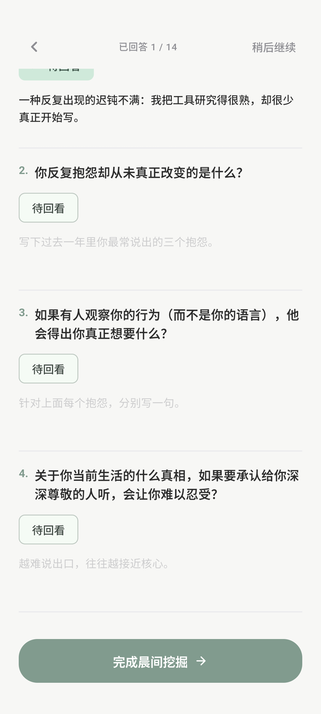
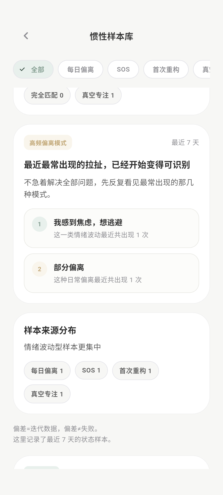

<p align="center">
  
</p>

<h1 align="center">ResetSelf</h1>

<p align="center"><b>不记录你坚持了多少天，只记录你没坚持下来的那些瞬间。</b></p>

<p align="center">
  <a href="LICENSE"></a>
  <a href="https://github.com/gx1727/resetself/releases"></a>
  
  
</p>

<p align="center">
  
  
  
</p>

一个**本地优先、完全开源**的 Android 应用：晨间用 14 个问题探索方向，日间观察真实行为，晚间综合成明天可以尝试的方向与最小启动行动。全程不打卡、不打分、不联网。

方法依据 Dan Koe 的《How to fix your entire life in 1 day》；数字记录、跨日继续、最小启动行动与周回顾是产品适配或扩展，手册中已逐项标注。

源码、Issue 与版本发布都在本仓库。所有人的记录只留在各自设备的 SQLite 里，没有账号、没有服务端。

## 快速开始

- **下载安装**：[Releases](https://github.com/gx1727/resetself/releases) 中的 `app-release.apk`（Android，已签名）。连接设备后 `adb install -r app-release.apk`，或在手机上允许「未知来源」后直接安装。
- **使用手册**：<https://gx1727.github.io/resetself/> —— 42 张实机截图 + 完整流程说明。
- **从源码运行**：见下方[本地开发](#本地开发)。

## 它做什么

| 阶段 | 你会做什么 |
| --- | --- |
| 探索 | 晨间 14 个问题，写下「探索原稿」，不是一句结论 |
| 观察 | 白天 6 个示例时点加 3 条追问，拿真实行为核对晨间的解释 |
| 综合 | 晚间 11 步向导，整理成明天可以尝试的方向与最小启动行动 |
| 接住与回流 | 随时可用的 SOS 急救；每日校验与行动反馈把结果沉淀成样本 |

最后你看到的不是一个分数，而是最近 7 天你在哪儿反复偏离。

## 技术栈

| 方面 | 选型 |
| --- | --- |
| 框架 | Flutter，Dart SDK `^3.11.5`，当前仅支持 Android |
| 状态管理 | `flutter_riverpod` |
| 导航 | `go_router`，路由表集中在 `lib/src/app/navigation/` |
| 存储 | `sqflite`，SQLite schema v13，全部数据在设备本地 |
| 文件 | `path_provider`（本地 JSON 备份目录） |
| 测试 | `flutter_test`、`integration_test`、`sqflite_common_ffi`（用真实 SQLite 跑迁移与备份兼容） |

## 当前能力与已知边界

- 晨间 14 问、日间六问及三条追问、晚间 11 步；晚间可恢复上次步骤，晨间可标记待回看问题。
- 草稿防抖顺序写入，普通返回和系统返回都等待保存；失败保留文字并可重试。日间与反馈需主动点击保存。
- 修改行动和方向时可留原因；重构中枢可查看晨稿归档、恢复原稿和查看行动修改历史。
- 支持查看日期范围内的观察、完整历史方向，以及本地 JSON 备份与恢复。
- Android 提醒开关只控制排程，通知送达依赖权限、电池与系统策略。
- 后台切换会尝试保存草稿，但系统强制结束进程前尚未落库的输入无法保证恢复。

## 本地开发

```bash
flutter pub get
flutter run
flutter analyze --no-pub
flutter test --no-pub
flutter build apk --debug --no-pub

# 连接 Android 模拟器或设备，使用独立临时数据库验证三阶段路径
flutter test --no-pub integration_test/reconstruction_flow_test.dart -d <device-id>
```

打发布包需要 Android 签名配置；`applicationId` 为 `com.gx1727.resetself`。

## 目录结构

- `lib/src/features/`：晨间、日间、晚间、首页、反馈、回顾与设置，按 feature 组织。
- `lib/src/core/widgets/`：草稿保存与退出保护、方向摘要、行动编辑、方法说明等共用组件。
- `lib/src/data/`：数据库迁移、模型、仓库与备份。
- `lib/src/app/`：路由、主题、全局状态与常驻系统能力。
- `test/`：保存竞态、交互回归、真实 SQLite 升级与备份兼容；测试使用临时文件。
- `integration_test/`：Android 三阶段与反馈路径，使用独立数据库，不清空原有记录。
- `doc/`：方法对齐规范、交付报告、数据表设计与使用手册；`docs/` 为手册的 GitHub Pages 入口。

## 数据与隐私

所有记录保存在设备本机数据库 `resetself_v1.db`（应用私有目录 `/data/user/0/com.gx1727.resetself/databases/`），应用不请求网络权限，也不上传任何内容。导出备份只写入应用文档目录的 `backups` 文件夹。

晨间保留一份当前原稿，修改会更新它。「归档原稿，开始新探索」会独立保存原稿和标记，清除未提交晚间草稿；恢复旧稿时先归档当前稿，已保存方向、观察和反馈保留。观察日期范围由用户核对，不代表自动绑定到归档批次。

## 文档索引

- [使用手册](doc/manual/使用手册.html)：面向使用者的完整说明，另有 Pages 在线阅读版。
- [方法定义与原文对齐规范](doc/ResetSelf%20方法定义与原文对齐规范.md)：每个功能对应原文哪一句、哪些是产品扩展。
- [原文精髓体验改造交付报告](doc/ResetSelf%20原文精髓体验改造交付报告.md)：改造范围与验证结论。
- [SQLite 数据表结构设计](doc/ResetSelf%20APP%20SQLite%20完整数据表结构设计.md)：schema 与迁移约定。
- [页面-路由-数据表映射表](doc/页面-路由-数据表映射表.md)：想改某个页面时先看这里。
- [原文中英对照](doc/How-to-fix-your-entire-life-in-1-day_中英对照.md)：方法出处。

`doc/` 下其余历史产品文档记录了设计过程中的设想，不等于当前运行能力。

## 参与贡献

Issue 和 Pull Request 都欢迎，包括问题反馈、文案校对、文档补全和新功能建议。

- 改动前建议先开 Issue 对齐范围，尤其是涉及问卷题目、存储 schema 与文案的改动。
- 提交前请本地通过 `flutter analyze --no-pub` 与 `flutter test --no-pub`；涉及页面流程的改动请补跑对应的 `integration_test`。
- 提交信息沿用仓库现有风格：`feat:` / `fix:` / `docs:` / `test:` 加中文说明。
- 新增或修改用户可见文案时，请同步更新 `doc/` 中对应的规范文档与手册。

## 许可证

本项目基于 [MIT License](LICENSE) 开源。

## 免责声明

ResetSelf 是自我记录工具，不提供心理或医疗建议，也不能替代专业帮助。记录次数与问卷提交不证明身份或心理已改变。手册与仓库文档中的身份、信念与样本内容均为演示数据。
