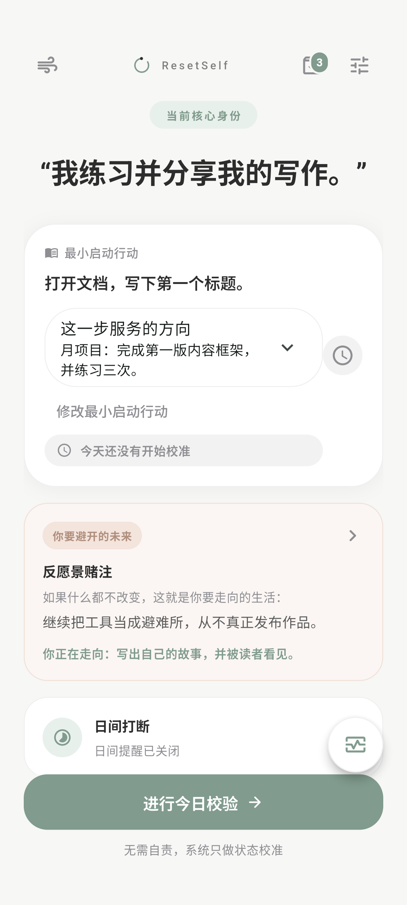

<p align="center">
  
</p>

<h1 align="center">ResetSelf</h1>

<p align="center"><b>不记录你坚持了多少天，只记录你没坚持下来的那些瞬间。</b></p>

<p align="center">
  
  
  
</p>

一个本地优先的 Android 应用：晨间用 14 个问题探索方向，日间观察真实行为，晚间综合成明天可以尝试的方向与最小启动行动。全程不打卡、不打分、不联网。

方法依据 Dan Koe 的《How to fix your entire life in 1 day》；数字记录、跨日继续、最小启动行动与周回顾是产品适配或扩展。

## 快速开始

- **使用手册**：<https://gx1727.github.io/resetself/> —— 42 张实机截图 + 完整流程说明
- **下载安装**：[Releases](https://github.com/gx1727/resetself/releases/latest) 中的 `app-release.apk`（Android，已签名）

## 它做什么

| 阶段 | 你会做什么 |
| --- | --- |
| 探索 | 晨间 14 个问题，写下「探索原稿」，不是一句结论 |
| 观察 | 白天 6 个示例时点加 3 条追问，拿真实行为核对晨间的解释 |
| 综合 | 晚间 11 步向导，整理成明天可以尝试的方向与最小启动行动 |
| 接住与回流 | 随时可用的 SOS 急救；每日校验与行动反馈把结果沉淀成样本 |

最后你看到的不是一个分数，而是最近 7 天你在哪儿反复偏离。

## 当前状态

- Flutter 主工程，当前支持 Android；Riverpod 管理状态，GoRouter 管理首页中枢导航。
- SQLite v13 保存晨间原稿与批次归档、晚间草稿与方向、观察、反馈和行动修改历史；提供本地 JSON 备份与恢复。
- 晨间 14 问、日间六问及三条追问、晚间 11 步保留；支持查看日期范围内的观察、主动修改行动及查看完整历史方向。
- 草稿防抖顺序写入，普通返回和系统返回等待保存；失败保留文字并可重试。日间与反馈需主动点击保存。
- 晚间恢复上次步骤；晨间可标记待回看问题；修改行动和方向时可留原因。重构中枢可查看晨稿归档、恢复原稿和查看行动修改历史。
- Android 提醒开关只控制排程。通知送达依赖权限、电池与系统策略。

## 本地开发

```bash
flutter pub get
flutter run
flutter analyze --no-pub
flutter test --no-pub
flutter build apk --debug --no-pub
# 连接 Android 模拟器或设备，使用独立临时数据库验证三阶段路径
flutter test --no-pub integration_test/reconstruction_flow_test.dart -d <device-id>
```

## 目录与数据边界

- `lib/src/features/`：晨间、日间、晚间、首页、反馈、回顾与设置。
- `lib/src/core/widgets/`：草稿保存与退出保护、方向摘要、行动编辑、方法说明。
- `lib/src/data/`：数据库迁移、模型、仓库与备份。
- `test/`：保存竞态、交互回归、真实 SQLite 升级与备份兼容；测试使用临时文件。
- `integration_test/`：Android 三阶段与反馈路径，使用独立数据库，不清空原有记录。

晨间保留一份当前原稿，修改会更新它。“归档原稿，开始新探索”会独立保存原稿和标记，清除未提交晚间草稿；恢复旧稿时先归档当前稿，已保存方向、观察和反馈保留。观察日期范围由用户核对，不代表自动绑定到归档批次。后台切换会尝试保存草稿，系统强制结束进程前尚未落库的输入无法保证恢复。记录次数与问卷提交不证明身份或心理已改变。

实施与验证范围见 [改造交付报告](doc/ResetSelf%20原文精髓体验改造交付报告.md)；方法依据见 [对齐规范](doc/ResetSelf%20方法定义与原文对齐规范.md)。历史产品文档中的设想不等于当前运行能力。
